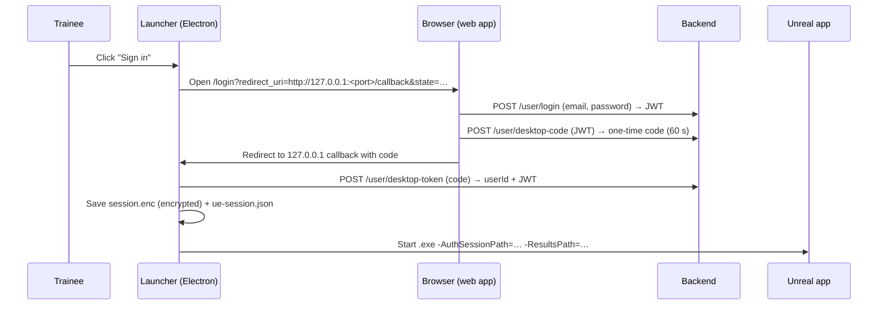
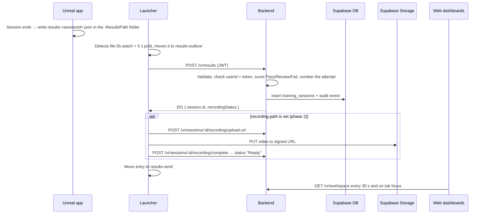

# VR Pharma — How the System Works

Status as of 19 Oct 2026. This covers how the pieces fit together today, what has to change for production, which events push data to the server, and what is still left. The plan is to ship **analytics first** (scores, steps, errors) and **recordings second** (session video).

---

## 1. The four pieces

| Piece | Where | What it does |
| --- | --- | --- |
| **VR application** | Packaged Unreal Engine `.exe`, **not in this repo** | Runs the training rooms, scores the trainee, writes one `results-<sessionId>.json` per session (and later a video file). |
| **Desktop launcher** | `desktop/` (Electron) | Signs the trainee in through the browser, starts the VR `.exe`, watches for results files and uploads them. |
| **Backend API** | `backend/` (Node/Express) | Login, invitations, validates and stores VR results, issues recording upload URLs, serves the dashboard feed. |
| **Web app** | `frontend/` (React/Vite) | Login page and the four role dashboards: learner, trainer, manager (head), admin. |

Data lives in **Supabase**: Postgres tables (`users`, `invitations`, `training_sessions`, `session_feedback`, `programs`, `audit_events`, `desktop_auth_codes`) and a private Storage bucket, `session-recordings`.

> `vr-pharma-source/` in the parent folder is a static HTML prototype of the UI. It is not part of the running system.

---

## 2. How it works right now

### 2.1 Sign-in and launch



- `ue-session.json` contains `{ userId, accessToken, isLoggedIn }`. Unreal only needs the **`userId`**.
- The JWT lasts **2 hours** (`backend/src/controller/loginController.js`). There is no refresh token.
- On later starts the launcher restores the saved session and starts the VR app without a browser round-trip, as long as the token is still valid.
- Logging out of the launcher kills the VR process and deletes both session files.

### 2.2 Results upload (already built on the launcher and server side)



Reliability features that already exist:

- **Offline-safe.** Failed uploads stay in `results-outbox/` and retry every 60 s and after every sign-in.
- **No duplicates.** Re-sending the same `sessionId` returns the stored session.
- **Wrong user.** Results whose `userId` doesn't match the signed-in user wait in the outbox until that user signs in. If the server rejects them (403), they go to `results-rejected/`.
- **Invalid files.** Unreadable files and validation failures (400) go to `results-rejected/` and are logged on the admin audit page.
- **Late attempts.** Results that arrive late are numbered by `completedAt`, and later attempts shift up.

Launcher data folder on Windows: `C:\Users\<user>\AppData\Roaming\VR Simulation Launcher\` (`results\`, `results-outbox\`, `results-sent\`, `results-rejected\`).

### 2.3 Scoring rules (server side, `backend/src/config/rooms.js`)

- Any error on a step marked `critical` → **Fail**.
- Otherwise: score ≥ 80 → **Pass**, 70–79 → **Review** (a trainer signs it off), < 70 → **Fail**.
- A `"complete"` run is averaged over all **11 rooms**. Rooms that weren't visited count as 0.
- Room ids: `gowning`, `wash`, `cleanstore`, `goods`, `dispensary`, `granulation`, `blending`, `tableting`, `blister`, `cartoning`, `water`.

### 2.4 Who sees what

| Role | Web workspace | Sees |
| --- | --- | --- |
| admin | `#/admin` | Everyone, audit log, integration health, storage use; invites admins and heads |
| head | `#/manager` | Heads, trainers, trainees; invites trainers and trainees; creates programs (rooms + deadline per batch) |
| trainer | `#/trainer` | Only their assigned trainees; reviews sessions and leaves feedback |
| trainee | `#/learner` | Only their own sessions, progress, feedback marked "learner" |

All analytics (averages, pass rates, trends, room breakdowns) are computed in the browser from the `/vr/workspace` feed (`frontend/src/lib/model.js`). The server stores only per-session data.

---

## 3. The events that push data to the server

This is the contract the **Unreal developer** must implement. Everything after step 5 is already done by the launcher.

| # | Event in Unreal | What Unreal must do |
| --- | --- | --- |
| 1 | **App start** | Read the `-AuthSessionPath=` and `-ResultsPath=` command-line values. Load `userId` from the session file. If it's missing, show "Start the VR app from the launcher". |
| 2 | **Session start** (trainee enters a room, or starts a full run) | Create a unique `sessionId`, e.g. `VR-<yyyyMMdd-HHmmss>-<random>`, 8–128 chars of `A-Z a-z 0-9 . _ : -`. Record `startedAt` (ISO 8601 UTC). *Phase 2: start recording.* |
| 3 | **Each step completed or failed** | Append `{ index, points, maxPoints, critical, error, timestampSeconds }` to the room's `steps`. `index` is the 0-based step in that room's process order. |
| 4 | **Room finished** | Set the room's `score` (0–100) and `durationSeconds`, plus optional `competencies`. For a complete run, also set `recordingOffsetSeconds`. |
| 5 | **Session finished** (room done, run done, or the trainee quits) | *Phase 2: stop the recording and wait until the video file is closed.* Then write the results **atomically to a file of its own** in the folder of `-ResultsPath`: write `results-<sessionId>.json.tmp`, then rename it to `results-<sessionId>.json` (e.g. `results-VR-1048.json`). Use only letters, digits, `.`, `_`, `-` in the name. |
| 6 | *(launcher)* | Detects each file within about 1–5 s (or on its next start, if it was closed), queues it by `sessionId`, uploads it once, then deletes it. |
| 7 | *(web)* | The new session appears on dashboards within 30 s. |

Rules for Unreal:

- Write **one file per session** with a unique name. Never overwrite another session's file. The launcher deletes each file after queueing it. (Older builds that write the fixed `results.json` still work, but two sessions finishing before the launcher picks up the first would overwrite each other.)
- `type: "room"` must contain **exactly one** room. `type: "complete"` contains every room the trainee visited, each listed once.
- Copy `userId` exactly from `ue-session.json`. Never hard-code it.
- If the trainee quits halfway, still write the file with the steps done so far, so the attempt is recorded.

Minimal phase 1 file (no video):

```json
{
  "schemaVersion": 1,
  "sessionId": "VR-20261019-091200-a1b2",
  "userId": "<userId from ue-session.json>",
  "type": "room",
  "startedAt": "2026-10-19T09:12:00Z",
  "completedAt": "2026-10-19T09:46:00Z",
  "rooms": [{
    "roomId": "granulation",
    "score": 74,
    "durationSeconds": 2040,
    "steps": [
      { "index": 0, "points": 10, "maxPoints": 10, "critical": false, "error": null, "timestampSeconds": 35 },
      { "index": 1, "points": 0, "maxPoints": 15, "critical": true, "error": "Binder added with the impeller stopped", "timestampSeconds": 410 }
    ],
    "competencies": [{ "name": "Equipment handling", "score": 80 }]
  }],
  "recording": null
}
```

The full field reference is in `desktop/README.md` under "VR results hand-off".

---

## 4. Phase 1 — Analytics (do this first)

**Goal:** every finished VR session shows up on the trainee, trainer, head and admin dashboards with score, result, steps and errors. No video yet: always send `"recording": null`.

### Steps

1. **Unreal:** implement events 1–5 from section 3, without recording.
2. **Server-only test first (no Unreal needed).** Sign in as a trainee and post the sample file directly:
   ```bash
   TOKEN=$(curl -s -X POST $API/user/login -H 'Content-Type: application/json' \
     -d '{"email":"aman.khan@linchpinglobal.net","password":"…"}' | jq -r .data.token)
   USER_ID=$(curl -s -X POST $API/user/login -H 'Content-Type: application/json' \
     -d '{"email":"aman.khan@linchpinglobal.net","password":"…"}' | jq -r .data.userId)
   # put $USER_ID into the sample file's userId, then:
   curl -X POST $API/vr/results -H "Authorization: Bearer $TOKEN" \
     -H 'Content-Type: application/json' -d @results.json
   ```
   Expect `201`. Then check the session appears for Aman (learner), Asad (trainer), Haseeb (head) and info@ (admin).
3. **Launcher test (still no Unreal).** Sign in to the launcher as the trainee, then drop the same file into `…\VR Simulation Launcher\results\results-<sessionId>.json`. Within a few seconds it should move to `results-sent\`, and the dashboard should update.
4. **Full test with Unreal.** Run one room and one complete run, then check the dashboards.
5. **Failure tests:** unplug the network before a session ends and reconnect (it should upload on retry). Send the same file twice (no duplicate). Send a file for a different user (it waits, and is never attached to the wrong person).

**Done when:** all four role dashboards show real Unreal sessions correctly, and the admin's "VR assessment ingestion" health shows 100%.

---

## 5. Phase 2 — Recordings

The launcher and server side is already built. What remains is mostly the Unreal recording, plus storage limits.

1. **Unreal records the session** to a video file (mp4 recommended; webm, mkv, mov and avi are accepted).
   - Start at event 2 and stop at event 5.
   - The file must be **fully written and closed before the results file is written**. The launcher waits up to about 10 minutes for the file, then marks the recording "Unavailable".
2. **Fill in the `recording` field:**
   `"recording": { "path": "recordings/<sessionId>.mp4", "durationSeconds": 2040 }`. The path is absolute or relative to the results file's folder.
3. **Timestamps:** `steps[].timestampSeconds` are seconds from the **start of the recording**, so the review page can jump to each mistake. For complete runs, set `rooms[].recordingOffsetSeconds`.
4. **Storage limits (must fix before go-live):**
   - The Supabase free plan caps uploads at **50 MB per file**. A 30-minute video is far larger. Upgrade the plan and raise the limit under Storage settings, or record at a lower bitrate or resolution (e.g. 720p).
   - Uploads are one HTTP PUT. For very large files on weak networks, switch to Supabase resumable (TUS) uploads in `desktop/src/main/results.ts`.
   - Set `RECORDING_STORAGE_QUOTA_GB` to the real plan size. Decide how long recordings are kept; nothing deletes them yet.
5. **Test:** after a session, the review page (`#/session/<id>`) plays the video. The status goes Processing → Ready. Admin "Recording media processing" health is 100%.

---

## 6. What must change for production

### Hosting and config

| Item | Now | Change to |
| --- | --- | --- |
| Backend + web hosting | Running locally (`localhost:8000`, `localhost:5173`) | Deploy. `vercel.json` already routes `/api/*` to the backend and everything else to the frontend. Put all `backend/.env` values in the host's environment settings. |
| `FRONTEND_URL` (CORS) | `http://localhost:5173` | The production web URL, e.g. `https://vr.linchpinglobal.net` |
| `VITE_API_URL` (web build) | Defaults to `http://localhost:8000/api/v1` | `https://<prod-domain>/api/v1`, set at build time |
| `VITE_COMPANY_NAME` | Example says "Meridian Pharmaceuticals" | The real company name |
| **Launcher URLs** | `WEB_URL` / `API_URL` read from `process.env`, defaulting to **localhost** | **Must be baked into the build.** Trainee PCs won't have these env vars, so an installed launcher would try `localhost` and fail. Switch to `import.meta.env.MAIN_VITE_WEB_URL` / `MAIN_VITE_API_URL` (electron-vite inlines these at build time) and build with the production URLs. |
| Launcher installer | Unsigned ("Unknown publisher") | Sign with a code-signing certificate (see `desktop/README.md`) |
| `SMTP_FROM` | `ListingIQ <no-reply@…>` | The VR Pharma sender name |
| `ADMIN_*` in `.env` | Placeholder values | Remove; the first admin already exists |

### Security

- **Rotate secrets.** A database password from an earlier project sat in plain text in `.env`. Use a strong `JWT_SECRET_KEY` and never commit `.env`.
- **Remove `POST /api/v1/user/training-sessions`.** It lets a trainee post any score for themselves. The web app doesn't use it; real results come only through `/vr/results`.
- **Rate-limit `POST /user/login`.** There is currently no limit on password attempts.
- **Token lifetime.** The 2 h JWT means a launcher left open for a day stops uploading until the trainee signs in again. Results are safe in the outbox, but nothing uploads until then. Consider a longer-lived launcher-only token or a refresh flow.
- **Weak passwords.** The current accounts use easily guessed passwords; have them changed. There is no "change password" or "reset password" feature yet (see section 7).

---

## 7. What is left

### Must do before go-live

- [ ] **Unreal integration (phase 1):** read the launch arguments, generate `sessionId`, collect steps, write `results-<sessionId>.json` atomically. *Nothing in this repo does this. It's the main remaining work.*
- [ ] Confirm the step lists per room: the `index` order Unreal uses must match the process order shown in the web app (`frontend/src/content/catalog.js`). **Granulation and Gowning have no step list there yet** (`steps: null`); add them.
- [ ] Bake production URLs into the launcher build and sign the installer.
- [ ] Deploy the backend and frontend, and set production env vars and CORS.
- [ ] Remove the `/user/training-sessions` endpoint; add login rate-limiting.
- [ ] Run the phase 1 test plan (section 4) end to end on a real trainee PC.

### Phase 2

- [ ] Unreal session recording, with the file closed before the results file.
- [ ] Storage plan upgrade and file-size limit, or lower-bitrate recordings.
- [ ] Recording retention and cleanup policy.
- [ ] Optional: resumable uploads for large videos.

### Missing features

- [ ] Change password and forgot/reset password (the login page only says "contact your administrator").
- [ ] Editing and deactivating users from the UI (right now this is a database change).
- [ ] Token refresh for long launcher sessions.
- [ ] Automated tests: there are none for the backend, frontend or launcher.

### Not yet verified

- The launcher → Unreal → upload flow has not been run end to end in this environment. The backend login was tested, and all four accounts can sign in.
